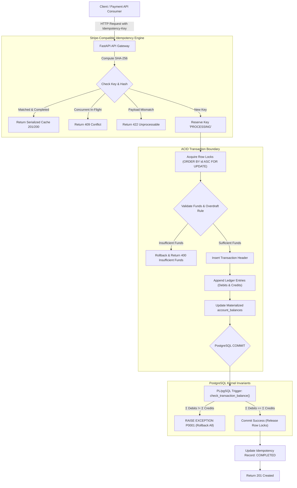
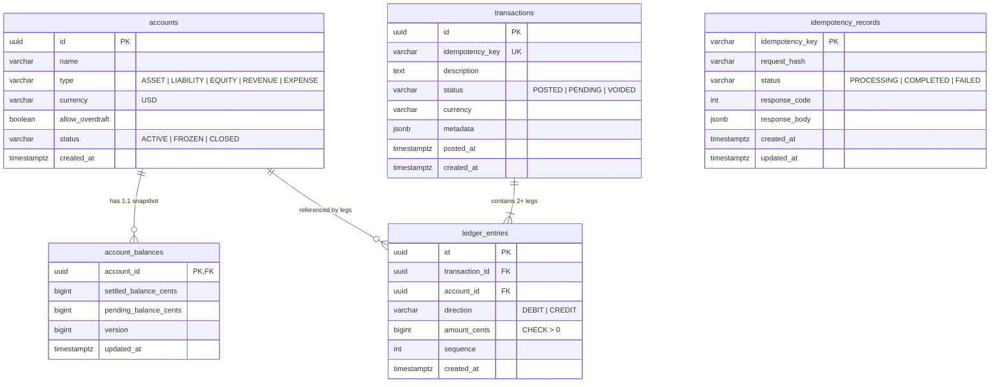

# LedgerCore — Production-Grade ACID Double-Entry Financial Ledger

[](https://www.postgresql.org/)
[](https://www.python.org/)
[](https://fastapi.tiangolo.com/)
[]()
[]()
[-success)]()

**LedgerCore** is a lightweight, reliable append-only double-entry financial ledger engine built with **PostgreSQL 16** and **Python (FastAPI)**. Designed with Stripe-grade architectural fundamentals, it enforces strict mathematical consistency across high-throughput concurrent workloads:

- **Strict Append-Only Immutability:** Financial ledger entries cannot be mutated (`UPDATE`) or destroyed (`DELETE`)—enforced at the database kernel level via triggers.
- **Zero-Sum Balance Invariant:** Every journal transaction must satisfy $\sum \text{Debits} - \sum \text{Credits} = 0$, enforced via **deferred PL/pgSQL constraint triggers** checked atomically at commit.
- **Deadlock-Free Row-Level Locking:** Prevents bank runs and double-spends under high concurrency by acquiring row locks in **deterministic ascending UUID order**, mathematically eliminating circular wait conditions.
- **Stripe-Compatible Idempotency Engine:** SHA-256 canonical request fingerprinting with atomic state machines preventing duplicate charges during network retries.
- **Point-in-Time Auditing (Window Functions):** Instant reconstruction of cumulative historical balances at any millisecond in history using PostgreSQL analytical window functions.
- **Two-Tier Balance Architecture:** $O(1)$ materialized balance cache paired with automated continuous reconciliation against raw ledger entries.

---

## 1. System Architecture



---

## 2. Cardinal Financial Invariants

### A. The Zero-Sum Invariant (PostgreSQL PL/pgSQL Trigger)
Double-entry bookkeeping mandates that money cannot be created or destroyed: every debit must have an equal and opposite credit. 

Rather than relying on application code that could be bypassed by raw SQL scripts or unexpected exceptions, LedgerCore implements a PostgreSQL **Constraint Trigger** configured as `DEFERRABLE INITIALLY DEFERRED`:

```sql
CREATE OR REPLACE FUNCTION check_transaction_balance()
RETURNS TRIGGER AS $$
DECLARE
    v_tx_id UUID;
    v_net_sum BIGINT;
BEGIN
    v_tx_id := COALESCE(NEW.transaction_id, OLD.transaction_id);

    SELECT COALESCE(SUM(CASE WHEN direction = 'DEBIT' THEN amount_cents ELSE -amount_cents END), 0)
    INTO v_net_sum
    FROM ledger_entries
    WHERE transaction_id = v_tx_id;

    IF v_net_sum != 0 THEN
        RAISE EXCEPTION 'Zero-sum transaction balance invariant violated for transaction %: discrepancy of % cents',
            v_tx_id, v_net_sum
            USING ERRCODE = 'P0001';
    END IF;

    RETURN NEW;
END;
$$ LANGUAGE plpgsql;

CREATE CONSTRAINT TRIGGER trg_check_transaction_balance
AFTER INSERT OR UPDATE OR DELETE ON ledger_entries
DEFERRABLE INITIALLY DEFERRED
FOR EACH ROW
EXECUTE FUNCTION check_transaction_balance();
```

> **Why `DEFERRED`?** In multi-leg transactions (e.g. customer charge with platform fee split), entries are inserted sequentially. An immediate trigger would fail on the first inserted leg. A deferred constraint trigger allows multi-leg insertions within the transaction and executes strictly at `COMMIT`.

---

### B. Concurrency & Deadlock-Free Overdraft Prevention
In high-throughput environments, multiple concurrent transfers between the same accounts can create race conditions (double-spends) or database deadlocks.

If Thread 1 executes $A \to B$ and Thread 2 executes $B \to A$:
- Thread 1 locks $A$, waits for $B$.
- Thread 2 locks $B$, waits for $A$.
- **Result:** PostgreSQL deadlock error `40P01`.

#### LedgerCore's Solution: Deterministic UUID Lock Ordering
LedgerCore mathematically eliminates deadlocks by sorting all participating account IDs before acquiring locks:

$$\text{Sorted IDs} = \text{sort}([A, B])$$

```sql
SELECT a.id, a.type, a.currency, a.allow_overdraft, b.settled_balance_cents
FROM accounts a
JOIN account_balances b ON a.id = b.account_id
WHERE a.id = ANY(:sorted_account_ids)
ORDER BY a.id ASC
FOR UPDATE OF a, b;
```
Because all workers acquire locks in the identical direction across the UUID key space, **circular wait conditions (Coffman conditions) are mathematically impossible**.

Under this row lock:
1. Available settled balance is verified against the transfer delta.
2. If `allow_overdraft = FALSE` and balance would drop below 0, an `InsufficientFundsError` is thrown, rolling back the transaction.

---

### C. Point-in-Time Auditing (Analytical Window Functions)
To reconstruct the exact historical balance after every transaction leg without mutating data, LedgerCore utilizes PostgreSQL Window Functions:

```sql
SELECT 
    t.posted_at,
    t.id AS transaction_id,
    t.description,
    le.direction,
    le.amount_cents,
    SUM(
        CASE 
            WHEN (a.type IN ('ASSET', 'EXPENSE') AND le.direction = 'DEBIT') THEN le.amount_cents
            WHEN (a.type IN ('ASSET', 'EXPENSE') AND le.direction = 'CREDIT') THEN -le.amount_cents
            WHEN (a.type IN ('LIABILITY', 'EQUITY', 'REVENUE') AND le.direction = 'CREDIT') THEN le.amount_cents
            ELSE -le.amount_cents
        END
    ) OVER (
        PARTITION BY le.account_id 
        ORDER BY t.posted_at ASC, le.id ASC
        ROWS BETWEEN UNBOUNDED PRECEDING AND CURRENT ROW
    ) AS running_balance_cents
FROM ledger_entries le
JOIN transactions t ON le.transaction_id = t.id
JOIN accounts a ON le.account_id = a.id
WHERE le.account_id = :target_account_id
ORDER BY t.posted_at ASC, le.id ASC;
```

---

### D. Stripe-Compatible Idempotency Engine
Prevents double-charging across network drops or client retries:
1. **Cryptographic Payload Fingerprint:**
   $$\text{Hash} = \text{SHA-256}(\text{Method} \mathbin{\Vert} \text{Path} \mathbin{\Vert} \text{CanonicalJSON}(\text{Body}))$$
2. **State Machine (`PROCESSING` $\to$ `COMPLETED` / `FAILED`):**
   - **Matching Key & Matching Body:** Returns cached response with header `X-Idempotent-Replay: true`. Zero database writes.
   - **Matching Key & Altered Body:** Rejected with `422 Unprocessable Entity` (`idempotency_payload_mismatch`).
   - **In-Flight Concurrent Key:** Returns `409 Conflict` (`idempotency_conflict`).

---

## 3. Database Schema



---

## 4. Benchmark & Stress Test Results

Executed via the test harness (`concurrency_test.py`):

```
                        Bank Run Race Results (Double-Spend Prevention)
+--------------------------------+----------+--------------------------+--------+
| Metric                         | Expected | Actual                   | Status |
+--------------------------------+----------+--------------------------+--------+
| Total Concurrent Requests      | 50       | 50                       | PASS   |
| Successful Withdrawals ($10)   | 10       | 10                       | PASS   |
| Overdraft Rejections (HTTP 400)| 40       | 40                       | PASS   |
| Database Deadlocks             | 0        | 0                        | PASS   |
| Final Settled Balance          | $0.00    | $0.00                    | PASS   |
| Throughput                     | -        | 976.5 req/sec (51.20 ms) | INFO   |
+--------------------------------+----------+--------------------------+--------+
✔ Invariant Enforced: Zero double-spends, zero negative balances, zero deadlocks.

                         Bidirectional Locking Stress Test
+--------------------------------+----------+--------------------------+--------+
| Metric                         | Expected | Actual                   | Status |
+--------------------------------+----------+--------------------------+--------+
| Total Simultaneous Transfers   | 100      | 100                      | PASS   |
| Successful Completions         | 100      | 100                      | PASS   |
| Deadlocks Detected (40P01)     | 0        | 0                        | PASS   |
| Throughput                     | -        | 424.1 transfers/sec      | INFO   |
+--------------------------------+----------+--------------------------+--------+
✔ Deadlock Freedom Confirmed: Deterministic UUID lock ordering succeeded.

                            Idempotency Storm Results
+--------------------------------+----------+--------------------------+--------+
| Metric                         | Expected | Actual                   | Status |
+--------------------------------+----------+--------------------------+--------+
| Total Storm Requests           | 50       | 50                       | PASS   |
| Original Ledger Postings       | 1        | 1                        | PASS   |
| Cached Replays Returned        | 49       | 49                       | INFO   |
| Destination Balance            | $50.00   | $50.00 (5,000 cents)     | PASS   |
+--------------------------------+----------+--------------------------+--------+
✔ Zero Duplicate Charges: Idempotency engine safely deduplicated all storm requests.
```

---

## 5. API Reference

| Method | Endpoint | Description |
| :--- | :--- | :--- |
| `GET` | `/v1/health` | Service health, PostgreSQL connection status, and ledger stats |
| `POST` | `/v1/accounts` | Create chart account (`ASSET`, `LIABILITY`, `EQUITY`, `REVENUE`, `EXPENSE`) |
| `GET` | `/v1/accounts` | List accounts with real-time materialized balances |
| `GET` | `/v1/accounts/{id}` | Retrieve account detail |
| `GET` | `/v1/accounts/{id}/balance` | Retrieve balance snapshot and optimistic concurrency version |
| `POST` | `/v1/transfers` | Execute atomic 2-legged transfer (with `Idempotency-Key` support) |
| `POST` | `/v1/transactions` | Post arbitrary multi-legged double-entry transaction |
| `GET` | `/v1/transactions` | Query posted journal entries |
| `GET` | `/v1/transactions/{id}` | Query transaction detail and all ledger legs |
| `GET` | `/v1/audit/accounts/{id}` | Point-in-time running balance timeline (Window Functions) |
| `POST` | `/v1/audit/reconcile` | Continuous system reconciliation (materialized cache vs raw sum) |
| `POST` | `/v1/demo/race` | Execute on-demand high-concurrency race condition benchmark |

---

## 6. Quickstart & Local Setup

### Option A: Using Docker Compose
```bash
git clone <repo-url>
cd Ledgercore
docker compose up --build
```
Open [http://localhost:8000](http://localhost:8000) to access the interactive dashboard and live race simulator.

---

### Option B: Local Setup with Python & PostgreSQL

#### 1. Prerequisites
- Python 3.11+
- PostgreSQL 14+ running locally

#### 2. Install & Configure
```bash
# Clone and enter repo
cd Ledgercore

# Setup virtualenv and dependencies
make setup

# Create local databases
createdb ledgercore
createdb ledgercore_test

# Apply schema and triggers
make migrate
```

#### 3. Run Automated Tests
```bash
make test
```
All 12 test suites will run, verifying zero-sum triggers, immutability, idempotency replays, overdraft prevention, and concurrency races.

#### 4. Run the Dev Server & Dashboard
```bash
make dev
```
Navigate to [http://127.0.0.1:8000](http://127.0.0.1:8000) for the Executive Dashboard and Live Race Simulator.

#### 5. Execute Concurrency Stress Benchmark
In another terminal:
```bash
make bench
# or:
python concurrency_test.py --workers 100
```

---

## 7. Architecture Decision Records (ADRs)

Detailed technical rationale and trade-off analysis:
- [ADR 001: Append-Only Immutable Ledger vs In-Place Balance Updates](docs/adr/001-immutable-append-only.md)
- [ADR 002: Deterministic Row-Level Lock Ordering for Deadlock Freedom](docs/adr/002-deterministic-row-locks.md)
- [ADR 003: Deferred Constraint Triggers for Atomic Zero-Sum Enforcement](docs/adr/003-deferred-constraint-triggers.md)
- [ADR 004: Stripe-Compatible Idempotency Key Specification & Request Hashing](docs/adr/004-stripe-idempotency-engine.md)
- [ADR 005: Two-Tier Balance Architecture: Materialized Snapshots + Analytical Auditing](docs/adr/005-two-tier-materialized-balances.md)

---

## License
MIT
